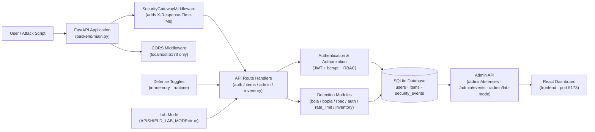
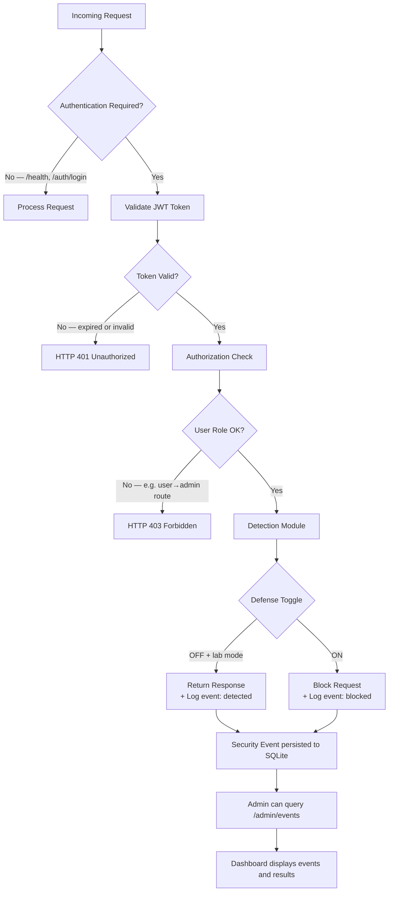

# 🛡️ APIShield

### A Controlled Platform for Simulating, Detecting, and Defending Against OWASP API Security Risks


---

APIShield is a **local, reproducible API security laboratory** built to demonstrate, detect, and defend against selected **OWASP API Security Top 10 (2023)** risks. The same API endpoint can be evaluated with its defense toggled OFF and then ON, producing a controlled comparison between vulnerable and defended behaviour.

```text
Attack → Detect → Defend → Verify
```

This is not just a secure API — it is an **experimental platform** where vulnerabilities are intentionally introduced in a safe, controlled, synthetic environment so they can be studied and mitigated.

---

## 📋 Table of Contents

- [Project Overview](#-project-overview)
- [Key Features](#-key-features)
- [OWASP Risks Implemented](#-owasp-risks-implemented)
- [System Architecture](#-system-architecture)
- [Project Structure](#-project-structure)
- [How APIShield Works](#-how-apishield-works)
- [Security Workflow](#-security-workflow)
- [Technology Stack](#-technology-stack)
- [Prerequisites](#-prerequisites)
- [Installation Guide](#-installation-guide)
- [Starting the Frontend](#-starting-the-frontend)
- [API Documentation](#-api-documentation)
- [Authentication and JWT](#-authentication-and-jwt)
- [Lab Mode vs Defense Toggles](#-lab-mode-vs-defense-toggles)
- [Attack Simulations](#-attack-simulations)
- [Security Event Detection](#-security-event-detection)
- [Experiment Results](#-experiment-results)
- [Frontend Dashboard](#-frontend-dashboard)
- [Automated Testing](#-automated-testing)
- [Docker](#-docker)
- [Safety Notice](#️-safety-notice)
- [Troubleshooting](#-troubleshooting)
- [Future Improvements](#-future-improvements)
- [Documentation](#-documentation)

---

## 🎯 Project Overview

Modern APIs are prime attack targets. The [OWASP API Security Top 10](https://owasp.org/API-Security/editions/2023/en/0x00-header/) describes the most critical API vulnerabilities — but reading about them is different from *seeing* them in action.

APIShield addresses this gap by providing:

- **A real FastAPI backend** with both secure and intentionally vulnerable code paths.
- **Runtime defense toggles** so the same endpoint can serve as vulnerable (defense OFF) and defended (defense ON) within a single session.
- **Attack simulation scripts** that execute controlled exploits against synthetic data only.
- **Automatic event correlation** — each attack script verifies that the correct security event was generated for that specific attack attempt.
- **A React dashboard** that displays experiment results, live defense states, and the security event log.

### The Dual-Run Pattern

Every experiment runs in two passes against the same endpoint:

```
Defense OFF                          Defense ON
     │                                    │
     ▼                                    ▼
Vulnerable Behaviour              Security Validation
     │                                    │
     ▼                                    ▼
Attack Succeeds                     Attack Blocked
     │                                    │
     ▼                                    ▼
Detection Event (action=detected)  Detection Event (action=blocked)
     │                                    │
     └──────────────┬─────────────────────┘
                    ▼
         Combined Results Written
         (only after both runs verified)
```

---

## ✨ Key Features

- 🔬 **Controlled local security laboratory** — all activity is confined to `127.0.0.1:8000`
- 🔀 **Runtime defense toggles** — enable/disable each defense via admin API without restarting
- 🧪 **Lab mode** — a startup flag that allows intentionally vulnerable code paths to execute
- 🔑 **JWT authentication** — HS256, 30-minute expiry, role-based (`user` / `admin`)
- 🔒 **bcrypt password hashing** — 12 rounds, passwords never stored or logged in plaintext
- 👥 **Role-based access control** — users can only access their own data; admin routes are enforced
- 📋 **Security event logging** — every detection and block is persisted in SQLite with full metadata
- ⚔️ **Six attack simulation scripts** — one per implemented OWASP category
- 🔍 **Six detection modules** — independent detectors with exact event ID correlation
- 📊 **React + Vite dashboard** — four-tab admin UI: Status, Defenses, Events, Results
- ✅ **162 automated tests** — covering authentication, authorization, every OWASP module, middleware, seeding, events
- 🐳 **Docker support** — containerized execution with non-root user and health check

---

## 🛡️ OWASP Risks Implemented

| OWASP Category | Risk | Attack Script | Detection Module | Defense Toggle |
|---|---|---|---|---|
| **API1:2023** | Broken Object Level Authorization (BOLA) | `attacks/bola.py` | `detection/bola.py` | `bola` |
| **API2:2023** | Broken Authentication | `attacks/auth.py` | `detection/auth.py` | `auth_hardening` |
| **API3:2023** | Broken Object Property Level Authorization (BOPLA) | `attacks/bopla.py` | `detection/bopla.py` | `schema_validation` |
| **API4:2023** | Unrestricted Resource Consumption | `attacks/rate_limit.py` | `detection/rate_limit.py` | `rate_limit` |
| **API5:2023** | Broken Function Level Authorization (BFLA) | `attacks/rbac.py` | `detection/rbac.py` | `rbac` |
| **API9:2023** | Improper Inventory Management | `attacks/inventory.py` | `detection/inventory.py` | `deprecated_route_protection` |

---

## 🏗️ System Architecture



---

## 📁 Project Structure

```text
APIShield/
│
├── backend/                    # FastAPI application
│   ├── main.py                 # App entrypoint, routers, CORS, middleware
│   ├── config.py               # JWT config, lab mode flag, .env loader
│   ├── database.py             # SQLAlchemy engine and session factory
│   ├── seed.py                 # Deterministic synthetic data seeding
│   ├── auth/
│   │   ├── security.py         # bcrypt hashing, JWT creation/validation
│   │   └── deps.py             # FastAPI dependency: get_current_user
│   ├── models/
│   │   ├── user.py             # User ORM model
│   │   ├── item.py             # Item ORM model (with internal fields)
│   │   └── event.py            # SecurityEvent ORM model
│   ├── routes/
│   │   ├── auth.py             # POST /auth/login (with lockout check)
│   │   ├── items.py            # GET /items/{id} (BOLA + BOPLA detection)
│   │   ├── admin.py            # /admin/defenses, /admin/events, /admin/lab-mode
│   │   └── inventory.py        # /admin/inventory + deprecated /api/v0/items/{id}
│   └── security/
│       ├── defenses.py         # DefenseManager — runtime toggle state
│       ├── events.py           # Security event persistence helper
│       ├── lockout.py          # LoginAttemptTracker (Broken Authentication)
│       ├── rate_limiter.py     # Fixed-window RateLimiter (Resource Consumption)
│       ├── rate_limit_dep.py   # FastAPI dependency for rate limiting
│       └── middleware.py       # SecurityGatewayMiddleware (latency header)
│
├── attacks/                    # Controlled attack simulation scripts
│   ├── bola.py                 # API1 — cross-user object access (dual-run)
│   ├── auth.py                 # API2 — brute-force login attempts (dual-run)
│   ├── bopla.py                # API3 — excessive property exposure (dual-run)
│   ├── rate_limit.py           # API4 — request burst flooding (dual-run)
│   ├── rbac.py                 # API5 — unauthorized admin function (dual-run)
│   └── inventory.py            # API9 — deprecated route access (dual-run)
│
├── detection/                  # Independent detection logic
│   ├── bola.py                 # Detects cross-tenant object access
│   ├── auth.py                 # Detects brute-force attempts
│   ├── bopla.py                # Detects restricted property disclosure
│   ├── rate_limit.py           # Detects excessive request consumption
│   ├── rbac.py                 # Detects unauthorized function access
│   └── inventory.py            # Detects deprecated route access
│
├── tests/                      # pytest test suite (162 tests)
│   ├── conftest.py             # Shared fixtures: in-memory SQLite, test client
│   ├── test_bola.py
│   ├── test_auth_hardening.py
│   ├── test_bopla.py
│   ├── test_rate_limit.py
│   ├── test_rbac.py
│   ├── test_inventory.py
│   ├── test_auth.py
│   ├── test_defenses.py
│   ├── test_events.py
│   ├── test_items.py
│   ├── test_middleware.py
│   └── test_seed.py
│
├── frontend/                   # React + Vite security dashboard
│   ├── src/
│   │   ├── App.jsx             # Main dashboard UI (four tabs)
│   │   └── api.js              # API client (health, lab-mode, defenses, events, login)
│   └── public/results/         # JSON result files served to the dashboard
│
├── docs/
│   ├── ARCHITECTURE.md
│   ├── SECURITY_MODEL.md
│   ├── EXPERIMENT_METHODOLOGY.md
│   ├── TESTING.md
│   ├── FINAL_REPORT.md
│   └── results/                # Experiment result JSON files
│       ├── bola_results.json
│       ├── bopla_read_results.json
│       ├── auth_results.json
│       ├── rate_limit_results.json
│       ├── rbac_results.json
│       └── evaluation_summary.json
│
├── scripts/
│   └── evaluate.py             # Multi-run evaluation framework (requires live server)
│
├── Dockerfile
├── docker-compose.yml
├── requirements.txt
├── SPEC.md
└── README.md
```

---

## ⚙️ How APIShield Works

Here is the full lifecycle of an experiment, step by step:

1. **Start the server in lab mode** — without `APISHIELD_LAB_MODE=true`, all intentionally vulnerable code paths are disabled.
2. **Authenticate** — `POST /auth/login` with synthetic credentials returns a JWT token.
3. **Receive a JWT** — the token (HS256, 30-minute expiry) is included in all subsequent requests as `Authorization: Bearer <token>`.
4. **Access a protected endpoint** — for example, `GET /items/3`.
5. **Simulate the attack** — the attack script sends a request that violates the security policy (e.g., Alice accessing Bob's item).
6. **Detection logic runs** — the route handler calls the relevant detection module, which checks the request against the security rules.
7. **A security event is generated** — the event is written to the `security_events` SQLite table with the OWASP category, rule name, action, severity, user ID, and object ID.
8. **Defense decides the response** — if the defense toggle is OFF, the vulnerable response is returned and the event action is `detected`. If the defense is ON, the request is blocked and the event action is `blocked`.
9. **The attack script verifies the event** — using a pre-attack baseline event ID, the script checks that a matching event was created for this specific attempt.
10. **Results are written** — the combined dual-run JSON is written only after both runs pass verification and the defense state is restored.
11. **Dashboard displays results** — the React dashboard reads the result JSON files and renders experiment cards for each OWASP module.

---

## 🔄 Security Workflow



---

## 🧰 Technology Stack

| Layer | Technology | Purpose |
|---|---|---|
| Backend | Python 3.12 + FastAPI | Async REST API, automatic OpenAPI docs |
| ORM | SQLAlchemy 2.x | Database models and sessions |
| Database | SQLite | Persistent storage for users, items, events |
| Authentication | PyJWT (HS256) | Stateless JWT generation and validation |
| Password Security | bcrypt (12 rounds) | Secure one-way password hashing |
| Frontend | React 19 + Vite 8 | Admin dashboard for live status and results |
| Testing | pytest + httpx | 162 automated tests with in-memory SQLite |
| HTTP Client | httpx | Used in attack scripts and test client |
| Environment | python-dotenv | Load `.env` variables at startup |
| Containers | Docker + Compose | Containerized single-service deployment |

---

## 📦 Prerequisites

| Requirement | Notes |
|---|---|
| Python 3.12 or later | Tested with Python 3.12 and 3.14 |
| Node.js 18+ and npm | Required for the React frontend only |
| Git | To clone the repository |
| Docker (optional) | Only needed for the containerized setup |

---

## 🚀 Installation Guide

### 1. Clone the Repository

```powershell
git clone <REPOSITORY_URL>
cd apishield
```

### 2. Create a Python Virtual Environment

A virtual environment keeps project dependencies isolated from your system Python installation.

```powershell
python -m venv .venv
```

### 3. Activate the Virtual Environment

```powershell
.\.venv\Scripts\Activate.ps1
```

> **PowerShell execution policy:** If you see a script execution error, run this once for the current session only:
> ```powershell
> Set-ExecutionPolicy -ExecutionPolicy RemoteSigned -Scope Process
> ```

### 4. Install Python Dependencies

```powershell
pip install -r requirements.txt
```

This installs: `fastapi`, `uvicorn`, `sqlalchemy`, `bcrypt`, `pyjwt`, `httpx`, `pytest`, `python-dotenv`.

### 5. Configure the Environment

```powershell
Copy-Item .env.example .env
```

Open `.env` and set a strong random secret for JWT signing:

```text
JWT_SECRET=replace-this-with-a-strong-random-string-at-least-32-characters
```

> ⚠️ Never commit your `.env` file. It is listed in `.gitignore`. If `JWT_SECRET` is missing or shorter than 32 characters at startup, the server generates a one-time ephemeral key and prints a warning to stderr.

### 6. Seed the Database

The seed script creates synthetic users and items in a local SQLite database (`apishield.db`). The seed is **idempotent** — it safely adds missing columns without destroying existing data.

```powershell
python -m backend.seed
```

> [!NOTE]
> **Synthetic local test credentials — not real accounts:**
> | Username | Password | Role | Owns |
> |---|---|---|---|
> | `alice` | `AliceSyntheticPass123!` | `user` | Items 1 and 2 |
> | `bob` | `BobSyntheticPass123!` | `user` | Items 3 and 4 |
> | `admin` | `AdminSyntheticPass123!` | `admin` | Baseline admin access |
>
> Passwords are stored exclusively as bcrypt hashes. These credentials are intentionally public synthetic fixtures for local evaluation only.

### 7. Run the Automated Tests

```powershell
python -m pytest tests/ -v
```

All 162 tests use an in-memory SQLite database — no live server required.

### 8. Start the Backend Server

#### Safe Mode (default)

Intentionally vulnerable code paths are **disabled**. This is the correct mode for exploring the API normally.

```powershell
python -m uvicorn backend.main:app --host 127.0.0.1 --port 8000
```

#### Experimental Lab Mode

Required for running attack experiments. Enables the controlled vulnerable code paths.

```powershell
$env:APISHIELD_LAB_MODE = "true"
python -m uvicorn backend.main:app --host 127.0.0.1 --port 8000
```

The server will be available at `http://127.0.0.1:8000`.

**To reset the database to a clean state:**

```powershell
Remove-Item apishield.db -ErrorAction SilentlyContinue
python -m backend.seed
```

---

## 🖥️ Starting the Frontend

The React dashboard runs in a **separate terminal** alongside the backend.

```powershell
cd frontend
npm install
npm run dev
```

The dashboard will be available at **`http://localhost:5173`**.

> CORS is configured in `backend/main.py` to allow requests from `http://localhost:5173` and `http://127.0.0.1:5173`. If you use a different port, you would need to update the allowed origins.

Log in with the `admin` synthetic credentials. The dashboard requires the backend to be running.

---

## 📖 API Documentation

FastAPI generates interactive documentation automatically.

Open in your browser while the backend is running:

```text
http://127.0.0.1:8000/docs    ← Swagger UI (interactive)
http://127.0.0.1:8000/redoc   ← ReDoc (read-only)
```

**To authorize requests in Swagger UI:**

1. Click **Authorize** (top right).
2. Enter the `Bearer` token obtained from `POST /auth/login`.
3. All subsequent requests in the UI will include the token.

**Key endpoints:**

| Method | Path | Auth | Description |
|---|---|---|---|
| `GET` | `/health` | None | Server liveness check |
| `POST` | `/auth/login` | None | Authenticate and receive JWT |
| `GET` | `/items/{id}` | JWT | Read an item (BOLA/BOPLA detection here) |
| `GET` | `/admin/defenses` | Admin JWT | Inspect all defense toggle states |
| `PATCH` | `/admin/defenses` | Admin JWT | Enable or disable one or more defenses |
| `GET` | `/admin/events` | Admin JWT | Query security event audit log |
| `GET` | `/admin/lab-mode` | Admin JWT | Check current lab mode status (read-only) |
| `GET` | `/admin/inventory` | Admin JWT | List all API routes including deprecated ones |
| `GET` | `/api/v0/items/{id}` | JWT | Deprecated route (lab mode + API9 experiment) |

---

## 🔑 Authentication and JWT

```
User submits username + password
          │
          ▼
bcrypt.verify(password, stored_hash)
          │
    ┌─────┴─────┐
  Fail          Pass
    │             │
 HTTP 401    JWT generated
              (HS256, 30 min expiry)
              payload: user_id, username, role
                   │
                   ▼
         Client stores token in memory
                   │
                   ▼
  Authorization: Bearer <token>  →  Protected route
                   │
                   ▼
         JWT decoded + signature verified
                   │
                   ▼
         Role and ownership checks
```

**Why bcrypt?** bcrypt is designed to be slow and computationally expensive for an attacker trying to crack hashed passwords, even if they obtain the hash.

**Why JWT?** JWTs are stateless — the server does not need a session store. The token itself carries the user's identity and role, verified by the shared secret on every request.

**Token expiry:** 30 minutes (`ACCESS_TOKEN_EXPIRE_MINUTES = 30` in `backend/config.py`).

**What is in the token?** The token payload contains the user ID (as subject), username, and role. It never contains the password.

---

## 🔐 Lab Mode vs Defense Toggles

There are two independent safety mechanisms:

### Lab Mode

Controlled by the **`APISHIELD_LAB_MODE`** environment variable set at **server startup**. It cannot be changed over HTTP.

| `APISHIELD_LAB_MODE` | Vulnerable code paths | Use case |
|---|---|---|
| `false` (default) | **Disabled** — safe mode | Normal API exploration |
| `true` | **Enabled** — lab mode | Running attack experiments |

> Even in lab mode, vulnerable behaviour only manifests when the corresponding defense toggle is also OFF.

### Defense Toggles

Runtime flags managed via `PATCH /admin/defenses` (admin only). All default to `false` (OFF) at startup.

| Toggle | OWASP Category | What It Protects |
|---|---|---|
| `bola` | API1:2023 | Object ownership — prevents cross-user item access |
| `auth_hardening` | API2:2023 | Login lockout — locks accounts after 5 failed attempts in 5 minutes |
| `schema_validation` | API3:2023 | Property access — blocks `?include_internal=true` on restricted fields |
| `rate_limit` | API4:2023 | Request limiting — 20 requests per 60-second window per user |
| `rbac` | API5:2023 | Function authorization — enforces admin-only route access |
| `deprecated_route_protection` | API9:2023 | Deprecated route blocking — returns 403 on `/api/v0/...` endpoints |

**Check defense states:**

```powershell
$token = (Invoke-RestMethod -Uri "http://127.0.0.1:8000/auth/login" `
  -Method Post `
  -Body '{"username":"admin","password":"AdminSyntheticPass123!"}' `
  -ContentType "application/json").access_token

Invoke-RestMethod -Uri "http://127.0.0.1:8000/admin/defenses" `
  -Headers @{Authorization="Bearer $token"}
```

**Toggle a defense:**

```powershell
Invoke-RestMethod -Uri "http://127.0.0.1:8000/admin/defenses" `
  -Method Patch `
  -Headers @{Authorization="Bearer $token"} `
  -Body '{"bola": true}' `
  -ContentType "application/json"
```

---

## ⚔️ Attack Simulations

All attack scripts follow the same safety pattern before making any network request:

1. Validate the target URL against a hardcoded allowlist (`http` scheme, hosts `127.0.0.1`/`localhost`/`api`, port `8000`).
2. Verify lab mode is enabled.
3. Capture the original defense state to restore it in a `finally` block.
4. Run two sequential passes (defense OFF, then defense ON).
5. Write combined results only after both passes are verified and the defense state is confirmed as restored.

---

### BOLA — API1:2023 (Broken Object Level Authorization)

**What is it?** An API that uses an object identifier (like an item ID) in the request but does not verify that the authenticated user is authorized to access that specific object. Alice can read Bob's data simply by changing the ID in the URL.

**Scenario in APIShield:**

```
Alice owns Items 1 and 2.
Bob owns Items 3 and 4.

Alice sends: GET /items/3
                    │
          Object Ownership Check
                    │
       ┌────────────┴────────────┐
  Defense OFF               Defense ON
       │                         │
  HTTP 200 — Bob's item     HTTP 403 — Blocked
  data returned              access denied
  event: detected            event: blocked
```

**Run the experiment:**

```powershell
# Start server in lab mode (separate terminal):
$env:APISHIELD_LAB_MODE = "true"
python -m uvicorn backend.main:app --host 127.0.0.1 --port 8000

# Run the dual-run experiment:
python attacks/bola.py --target http://127.0.0.1:8000
```

---

### Broken Authentication — API2:2023

**What is it?** An API that does not limit or detect repeated failed login attempts, allowing an attacker to brute-force passwords by trying thousands of combinations.

**Scenario in APIShield:** The script submits 7 incorrect login attempts for the target account (`alice`).

```
Defense OFF: All 7 attempts return HTTP 401. Account stays accessible.
             Brute-force is undetected.

Defense ON:  Attempts 1–5 return HTTP 401. At attempt 5, lockout triggers.
             Attempts 6–7 return HTTP 429 (Too Many Requests).
             Account is temporarily locked for 5 minutes.
```

**Lockout policy:** 5 failed attempts within 5 minutes → 5-minute account lockout (configured in `backend/security/lockout.py`).

**Run the experiment:**

```powershell
python attacks/auth.py --target http://127.0.0.1:8000
```

---

### BOPLA — API3:2023 (Broken Object Property Level Authorization)

**What is it?** An API that returns more data than the client should see — exposing internal, administrative, or sensitive properties that were not intended to be part of the response.

**Scenario in APIShield:** Alice requests her own Item 1 with the query parameter `?include_internal=true`, which asks the API to include the restricted fields `internal_notes` and `is_confidential`.

```
Defense OFF: HTTP 200 — Response includes internal_notes and is_confidential.
             Excessive data disclosed.

Defense ON:  HTTP 403 — The schema_validation defense rejects the request.
             Internal fields are never returned.
```

**Run the experiment:**

```powershell
python attacks/bopla.py --target http://127.0.0.1:8000
```

---

### Unrestricted Resource Consumption — API4:2023

**What is it?** An API that does not limit how many requests a client can make in a given time window, allowing a client to flood the server with requests and exhaust its resources.

**Scenario in APIShield:** The script sends a burst of 25 rapid requests to `GET /items/1` as Alice.

**Rate limit policy:** 20 requests per 60-second fixed window, keyed by authenticated user ID (`user:<id>` in `backend/security/rate_limiter.py`).

```
Defense OFF: All 25 requests return HTTP 200. No throttling.
             Block rate: 0%.

Defense ON:  After 20 requests, the limiter engages.
             Excess requests return HTTP 429 Too Many Requests.
             Block rate: 100% of over-limit requests.
```

**Run the experiment:**

```powershell
python attacks/rate_limit.py --target http://127.0.0.1:8000
```

---

### BFLA — API5:2023 (Broken Function Level Authorization)

**What is it?** An API that restricts endpoints based on authentication (the user is logged in) but does not properly check whether the user's *role* permits access to that specific *function*. A regular user reaches administrative endpoints.

**Scenario in APIShield:** Alice (role: `user`) sends a request to `GET /admin/events`, which is an admin-only endpoint.

```
Defense OFF: HTTP 200 — Alice receives the full security event log.
             Function-level authorization bypassed.

Defense ON:  HTTP 403 — RBAC check blocks Alice.
             Admin-only function protected.
```

**Run the experiment:**

```powershell
python attacks/rbac.py --target http://127.0.0.1:8000
```

---

### Improper Inventory Management — API9:2023

**What is it?** A production API that still has old, undocumented, or deprecated versions of endpoints accessible. These forgotten routes may lack the security controls of the current version.

**Scenario in APIShield:** A deprecated route `/api/v0/items/{id}` is exposed in lab mode. The `deprecated_route_protection` defense blocks access to this legacy endpoint.

```
Defense OFF: Deprecated route is accessible and returns item data.
             Legacy endpoint exposed.

Defense ON:  HTTP 403 — Route blocked by deprecated_route_protection.
             Inventory properly enforced.
```

**Run the experiment:**

```powershell
python attacks/inventory.py --target http://127.0.0.1:8000
```

---

## 🔎 Security Event Detection

Every security-relevant action is persisted in the `security_events` SQLite table. The event record contains:

| Field | Example | Description |
|---|---|---|
| `id` | `71` | Auto-increment primary key used for exact correlation |
| `timestamp` | `2026-10-23T04:37:30Z` | UTC time of the event |
| `user_id` | `1` | Foreign key to the authenticated user |
| `endpoint` | `/items/3` | The API path that triggered the detection |
| `method` | `GET` | HTTP method |
| `object_id` | `"3"` | The target object ID (string) |
| `owasp_category` | `API1:2023` | OWASP category classification |
| `severity` | `HIGH` | `LOW` / `MEDIUM` / `HIGH` / `CRITICAL` |
| `rule_name` | `bola_cross_tenant_access` | Machine-readable rule identifier |
| `action` | `detected` or `blocked` | Whether the defense intervened |

**`detected`** — the defense was OFF; the vulnerable behavior occurred; the event was logged for monitoring.

**`blocked`** — the defense was ON; the request was rejected; the event was logged to confirm the block.

### How Attack Scripts Verify Events

Each attack script captures the highest event ID *before* the attack (`latest_id_before`). After the attack, it queries for events where `id > latest_id_before` and all fields match (OWASP category, rule name, action, user ID, object ID). This guarantees the script verifies its *own specific event*, not a stale one from a previous run.

---

## 📊 Experiment Results

The following results are from live experiment runs against the local server.

| Experiment | Vulnerable Run | Defended Run |
|---|---|---|
| **BOLA** (API1) | HTTP 200 · `vulnerability_exploited` · detection ✓ | HTTP 403 · `attack_blocked` · detection ✓ |
| **BOPLA** (API3) | HTTP 200 · `vulnerability_exploited` · `internal_notes` disclosed · detection ✓ | HTTP 403 · `attack_blocked` · no disclosure · detection ✓ |
| **Broken Auth** (API2) | 7 × HTTP 401 · no lockout · `vulnerability_exploited` · detection ✓ | 5 × HTTP 401 + 2 × HTTP 429 · account locked · `attack_blocked` · detection ✓ |
| **Rate Limit** (API4) | 25/25 requests allowed · block rate 0.0 · p50 latency 6.25 ms | 25/25 requests blocked · block rate 1.0 · p50 latency 14.53 ms |
| **BFLA / RBAC** (API5) | HTTP 200 · admin events returned · `vulnerability_exploited` · detection ✓ | HTTP 403 · `attack_blocked` · detection ✓ |

> Result JSON files are in `docs/results/` and copied to `frontend/public/results/` for the dashboard. The `evaluation_summary.json` file is a placeholder — run `python scripts/evaluate.py --all --runs 10` against a live server to generate aggregate statistics.

---

## 🖥️ Frontend Dashboard

The React + Vite dashboard at `http://localhost:5173` provides four tabs:

| Tab | Contents |
|---|---|
| **Status** | API health indicator and current lab mode state |
| **Defenses** | Live toggle state for all six defenses with enable/disable buttons |
| **Events** | Paginated security event log with OWASP category, severity, rule, and action badges |
| **Results** | Experiment result cards for all five completed OWASP modules showing both Vulnerable Run and Defended Run outcome cards |

**How results are loaded:** The dashboard fetches static JSON files from `/results/*.json` served by Vite's public directory. It does not trigger attack scripts — it displays results generated by previously executed experiments.

**Security:** The JWT token is held in React component state only and is never persisted to `localStorage` or `sessionStorage`. Passwords are cleared from component state immediately after each login attempt.

---

## 🧪 Automated Testing

```powershell
python -m pytest tests/ -v
```

The full suite runs **162 tests** against an in-memory SQLite database — no live server required.

| Test file | Coverage |
|---|---|
| `test_bola.py` | BOLA detection, defense, dual-run orchestration, event correlation |
| `test_bopla.py` | BOPLA detection, schema_validation defense, event correlation |
| `test_auth_hardening.py` | Login lockout, attempt tracking, event logging |
| `test_rate_limit.py` | Fixed-window rate limiting, 429 responses, event logging |
| `test_rbac.py` | Function-level authorization, RBAC defense toggle |
| `test_inventory.py` | Deprecated route protection, API inventory endpoint |
| `test_auth.py` | Registration, login, JWT validation, bcrypt |
| `test_defenses.py` | DefenseManager: get, update, reset, unknown flag rejection |
| `test_events.py` | Security event persistence, pagination, action filter |
| `test_items.py` | Item CRUD, ownership, 404 handling |
| `test_middleware.py` | X-Response-Time-Ms header on all responses |
| `test_seed.py` | Idempotent seeding, column migration |

---

## 🐳 Docker

A `Dockerfile` and `docker-compose.yml` are included for containerized deployment. The container runs as a non-root user (`apishield`) and includes a health check on `GET /health`.

```powershell
# Build and start:
docker compose up --build

# Start in lab mode:
$env:JWT_SECRET = "your-strong-secret-here"
$env:APISHIELD_LAB_MODE = "true"
docker compose up --build
```

The `docker-compose.yml` passes `JWT_SECRET` from the host environment. Never hardcode secrets in the image.

> **Note:** The `docker-compose.yml` publishes port `8000` on `0.0.0.0` to allow host access to the container. For the local development setup (without Docker), the server always binds to `127.0.0.1` only.

---

## ⚠️ Safety Notice

APIShield is designed **exclusively** as a controlled educational and experimental environment.

- All attack scripts validate their target against a hardcoded allowlist (`127.0.0.1`, `localhost`, `api` Docker hostname) and refuse to run against any other host.
- The project uses **entirely synthetic users and data** — no real names, emails, or personal data.
- Intentionally vulnerable behavior requires **both** `APISHIELD_LAB_MODE=true` at startup **and** the corresponding defense toggle set to `false`.
- The application binds to `127.0.0.1:8000` in development to prevent exposure on the local network.
- Logs, events, and result files **never contain** passwords, JWT tokens, or Authorization header values.
- **Do not use the attack modules against any system without explicit authorization.**

---

## 🔧 Troubleshooting

### Port 8000 is already in use

```powershell
# Find the process using port 8000:
Get-NetTCPConnection -LocalPort 8000 -State Listen

# Stop it by Process ID (replace 1234 with the actual PID):
Stop-Process -Id 1234 -Force
```

### `ModuleNotFoundError: No module named 'backend'`

You must run Uvicorn from the **project root** directory (where `backend/` is a subdirectory):

```powershell
cd C:\path\to\apishield      # ← must be the project root
python -m uvicorn backend.main:app --host 127.0.0.1 --port 8000
```

### PowerShell will not run `.ps1` scripts

```powershell
Set-ExecutionPolicy -ExecutionPolicy RemoteSigned -Scope Process
.\.venv\Scripts\Activate.ps1
```

### Frontend cannot load experiment results

The dashboard reads JSON files from `frontend/public/results/`. After running an attack experiment, copy the generated result file:

```powershell
# Example for BOLA — replace filename as needed:
Copy-Item docs\results\bola_results.json frontend\public\results\bola_results.json
```

Then restart the Vite dev server or refresh the browser.

### CORS errors in the browser

The backend allows `http://localhost:5173` and `http://127.0.0.1:5173`. Ensure the frontend is running on port 5173 (the Vite default). Do not access the frontend via any other hostname or port.

### `JWT_SECRET` warning at startup

If you see a warning about an ephemeral key, your `.env` file is missing or the `JWT_SECRET` value is too short. Set a secret of at least 32 characters in `.env`.

---

## 🔭 Future Improvements

The following are possible extensions and are **not currently implemented**:

- **PostgreSQL support** — replace SQLite with a production-grade database, including distributed rate-limiter state via Redis.
- **Additional OWASP categories** — API6 (Unrestricted Access to Sensitive Business Flows), API7 (SSRF via local mock service), API8 (Security Misconfiguration).
- **Real-time dashboard updates** — WebSocket-based event streaming instead of static JSON files.
- **Multi-run evaluation statistics** — completing the `scripts/evaluate.py` framework with aggregate success rates, mean detection latency, and false-positive rates.
- **CI/CD integration** — run the full test suite on every push with GitHub Actions.
- **SIEM integration** — structured JSON log export to Splunk, Elastic, or similar.
- **Stronger API gateway** — middleware-layer decisions for more complex attack patterns.
- **Containerized experiment orchestration** — run all six experiments sequentially in Docker without manual steps.

---

## 📚 Documentation

| Document | Description |
|---|---|
| [SPEC.md](SPEC.md) | Full project specification and safety rules |
| [docs/ARCHITECTURE.md](docs/ARCHITECTURE.md) | Detailed component architecture |
| [docs/SECURITY_MODEL.md](docs/SECURITY_MODEL.md) | Defense model and threat assumptions |
| [docs/EXPERIMENT_METHODOLOGY.md](docs/EXPERIMENT_METHODOLOGY.md) | How experiments are designed and measured |
| [docs/TESTING.md](docs/TESTING.md) | Test organization and coverage notes |
| [docs/FINAL_REPORT.md](docs/FINAL_REPORT.md) | Comprehensive final project report |
| [docs/results/README.md](docs/results/README.md) | Result file schemas |

---

<div align="center">
<sub>APIShield — A controlled educational platform. Use responsibly.</sub>
</div>
